# ALFA Cognitive Stage على iPhone Duo — الامتداد الكامل والتكيّف (13 نوفمبر 2026)

نطاق هذه الجولة طبقة العرض فقط: كتلة جديدة في آخر [web/style.css](../web/style.css) وسطر واحد في [web/app.js](../web/app.js) يضع `data-role` (المحاضر / الطلبة / الملاحظات) على `<html>` حتى يعرف CSS أي نافذة يرسم. لم يُمَسّ الخادم ولا التصويت ولا الأمان ولا الاستيراد ولا تطبيق الماك ولا أي إعداد نشر.

رموز الحالة: `PASS` تحقق مُشاهد/مُختبر، `PARTIAL` جزئي، `FAIL` خلل باقٍ، `BLOCKED` يحتاج جهازًا أو إذنًا، `NOT_APPLICABLE` غير ذي صلة، `NOT_TESTED` لم يُختبر.

ملاحظة على المرجع: ملف التعليمات `00_MASTER_CLAUDE_CODE_AR.txt` لم يكن موجودًا على سطح المكتب وقت التنفيذ (كما وجدت الجلسات الأخرى). اعتمدتُ تعريفات الوضعيات A–J من وثيقة أوربت المماثلة، و`DUO_BRIEF.md`، وملاحظات تشغيل 13 نوفمبر.

## 1. نوع المشروع ومسار العرض

- خادم Node محلي ([server/server.mjs](../server/server.mjs)) يقدّم صفحات ثابتة من `web/`: لوحة المحاضر (`/#presenter`)، ونافذة الطلبة/البروجكتر (`/#audience`)، ونافذة الملاحظات (`/#notes`)، وصفحة تصويت الطلبة (`vote.html`) والمراجعة (`review.html`).
- لا استضافة عامة: يعمل على جهاز المحاضر (وتطبيق Electron للماك). **لا يوجد سير نشر في المستودع** (`.github/workflows/core-checks.yml` فحوص فقط)، فالدمج إلى `main` هو التسليم.
- جولات Duo السابقة (#65، #70، #73، #87) موجودة على `main`: نطاقات العرض (هاتف / كتاب / مكتب / أفقي قصير)، `dvh`، حواف الأمان، أهداف لمس. هذه الجولة لم تُعِد بناءها؛ أصلحت ما بقي فيها من جذور.

## 2. خط الأساس قبل التعديل (`origin/main` = `1bc203c`)

| الفحص | النتيجة |
|---|---|
| `node --check` لكل ملفات JS المتتبعة | PASS |
| 21 مجموعة وحدات من CI (`test:director` … `test:show`) | PASS 21/21 |
| `npm run test:build` | FAIL محليًا فقط: `python-pptx` غير مثبتة في بايثون النظام. PASS بعد تثبيتها في venv مؤقت (بيئة، لا خلل في الكود) |
| مصفوفة WebKit (15 مقاسًا × 8 شاشات = 120 حالة) | 0 تمرير أفقي، 0 أخطاء JS، وظهرت عيوب التكوين في القسم 3 |

لا يوجد lint ولا typecheck ولا خطوة build في هذا المستودع (JS خام بلا حزم).

ملاحظات بيئة محلية (لا تمس CI): `ffmpeg` المحلي بلا `libvorbis`، فبُني ملف الاختبار `tools/make_test_fixture.py` عبر غلاف مؤقت يحوّل الصوت إلى `libopus`.

## 3. ما وُجد وما أُصلح من جذوره

| # | العَرَض (قبل) | الجذر | الإصلاح |
|---|---|---|---|
| 1 | المطوي عرضيًا 594×368 و600×350 و951×350 (مفتوح مع لوحة مثبتة) و844×390 (آيفون عرضي): المفاتيح شريط واحد بشريط تمرير مخفي. «ابدأ العرض» و«التصويت» واختيار المحاضرة خارج الشاشة بلا أي إشارة، وزر «ارجع للشريحة الأصلية» مقصوص نصفه عند الحافة | في الارتفاع القصير كانت المفاتيح تبقى أسفل الشريحة (المحور النادر) فضُغطت في سطر يتمرر أفقيًا | تطبيقًا لنمط آبل في الارتفاع المضغوط (الأشرطة تنتقل إلى الجانب): المفاتيح **عمود عند حافة الشاشة** بمنطقة `keys` في شبكة `.main`، التالية ثم السابقة أولًا وبحجم أكبر. كل المفاتيح على الشاشة؛ العمود يتمرر (بشريط ظاهر) فقط حين تُضاف مفاتيح العرض الجاري |
| 2 | الشريحة في لوحة المحاضر تُحسب من ارتفاع النافذة ناقص أرقام ثابتة (`230px` و`140px` و`290px`)، فتتجاوز إطارها حين يكبر الشريط أو تلتف المفاتيح (على 951×600 كانت الشريحة تنتهي عند y=402 بينما صف المفاتيح يبدأ عند y=390، فتُقص حافتها السفلية داخل الإطار) | تقدير بالأرقام بدل قياس المساحة الفعلية | `.stage-wrap` صار **size container** في النطاقين اللذين ارتفاعه فيهما محدد (المكتب والأفقي القصير)، والشريحة `min(100cqw, 100cqh × aspect)`: تملأ ما بقي لها بالضبط مهما تغيّر ما حولها. داخل `@supports (width: 1cqw)`، والمحركات الأقدم تبقى على القواعد السابقة. وهامش الإطار يتناسب مع الارتفاع بين 481 و760px |
| 3 | المطوي عرضيًا 594×368: الشريط الجانبي (220px) + المفاتيح يتركان الشريحة صغيرة | النطاق الأفقي القصير يعامل 594px مثل 951px | تحت 720px عرضًا: الشاشة الأولى هي لوحة التحكم (الشريط، الشريحة، عمود المفاتيح)، والشريحة التالية والملاحظات تحتها بتمريرة واحدة. الشريحة صارت **437×246** بعد أن كانت 349×196 مع 4 مفاتيح مخفية |
| 4 | شاشات الخطأ («تعذر فتح هذه المحاضرة…» و«لا توجد محاضرة مفتوحة بعد»): أعلى من النافذة بـ16px في كل الوضعيات، والنص ملتصق بالأعلى، وخلفية بيضاء على نافذة البروجكتر الداكنة (وميض أبيض أثناء «جارٍ التحميل…» أيضًا) | هامش `
` ينهار عبر `.app` (margin collapse)، ولا هوية لشاشات الانتظار/الخطأ حسب النافذة | `data-role` على `<html>`؛ نافذتا الطلبة والملاحظات خلفيتهما داكنة من أول رسم؛ شاشات التحميل/الخطأ بطاقة واحدة في منتصف `100dvh` مع حواف الأمان وأيقونة شاشة بلون النحاس، والهامش المنهار أُلغي. لا تمرير زائد في أي وضعية |
| 5 | نافذة الملاحظات في الارتفاع القصير (951×350، 844×390): الصفحة أطول من النافذة، والمصغّرتان «الآن» و«التالية» فوق بعضهما | عمود جانبي عرضه 30% يكدّس الصورتين | تحت 480px ارتفاعًا: الصورتان جنبًا إلى جنب في عمود أعرض، وارتفاع النص `100dvh` ناقص الشريط. الصفحة صارت بارتفاع النافذة تمامًا |
| 6 | صفحة الطالب في حالة الانتظار / الرابط الناقص على الشاشة المفتوحة 669×880: الرسالة في الأعلى ونصف الشاشة السفلي فارغ | الصفحة عمود يبدأ من الأعلى بلا توزيع | حين تكون الحالة وحدها: `body` عمود مرن بارتفاع `100dvh`، الرسالة في منتصف الشاشة الأولى ومفتاحا «فاهم / ضايع» في منطقة الإبهام أسفلها. في الارتفاع القصير لا يتغير شيء (المحتوى أطول من النافذة أصلًا) |
| 7 | نافذة البروجكتر على جهاز فيه كاميرا أو زوايا دائرية: الشريحة تمتد تحتها | العرض يحسب `100vw/100dvh` كاملة | الخلفية تبقى ممتدة حافة لحافة، والشريحة تطرح `env(safe-area-inset-*)`. على البروجكتر الحواف صفر فلا يتغير شيء |
| 8 | قائمة اختيار المحاضرة على اللمس بخط أقل من 16px: Safari يكبّر الصفحة عند التركيز | — | `16px` تحت `pointer: coarse` |

## 4. فحص الامتداد الكامل

| البند | الحالة | الدليل |
|---|---|---|
| خلفية الجذر | PASS | لوحة المحاضر وصفحة الطلبة كما كانتا؛ نافذتا البروجكتر والملاحظات صارت خلفية `html` و`body` داكنة من أول رسم (حتى في التحميل والخطأ) |
| الحواف الأربع وحواف الأمان | PASS (محاكاة) | `.main` و`.side` وشاشات الخطأ وشريحة البروجكتر تأخذ `env(safe-area-inset-*)`. حواف Playwright صفر، فالقيم غير المتماثلة لم تُقَس على جهاز |
| تمرير أفقي | PASS | 0 في 120 حالة بعد التعديل، و0 في اختبار الانتقال الحي |
| تمرير عمودي غير مقصود | PASS | شاشات الخطأ والملاحظات بارتفاع النافذة؛ لوحة المحاضر في الأفقي العريض ثابتة `100dvh`؛ في الهاتف والمطوي العرضي الصفحة تتمرر عمدًا والشاشة الأولى كاملة |
| لوحة المفاتيح | NOT_TESTED | المحاكاة لا تُظهر لوحة مفاتيح حقيقية |

## 5. مصفوفة الوضعيات A–J (Playwright WebKit build 2370، ملف Safari المحمول، DPR 1.5، تقليل الحركة)

الشاشات في كل وضعية: المحاضر، البروجكتر (الشريحة)، الملاحظات، تصويت بسؤال مفتوح، تصويت برابط ناقص (انتظار)، المراجعة، خطأ البروجكتر، خطأ/فراغ المحاضر.

| الوضعية | المقاس | النتيجة | الحالة |
|---|---|---|---|
| A مطوي طولي | 382×580 | لا تغيير مقصود في لوحة المحاضر (كانت سليمة). الخطأ صار في المنتصف وبلا 16px زائدة | PASS (محاكاة) |
| B مطوي عرضي | 594×368، 600×350 | كل المفاتيح ظاهرة في عمود؛ الشريحة 437×246 (قبل 349×196 ومفاتيح مخفية) | PASS (محاكاة) |
| C مفتوح طولي | 669×880 | لوحة المحاضر كما هي؛ صفحة الانتظار متوازنة | PASS (محاكاة) |
| D مفتوح عرضي | 951×600، 951×585 | الشريحة تملأ إطارها بلا قص (قبل: تنزل 12px تحت بداية صف المفاتيح وتُقص). ثمنها أن الشريحة الكاملة المرئية صارت 505×284 بدل 551×310 المقصوصة | PASS (محاكاة) |
| E كتاب (طي عمودي) | — | لا يوجد في هذا المشروع تخطيط مخصص لـ Viewport Segments، ولم أضف واحدًا: Safari 27.1 يخفي الـ API خلف علم | NOT_TESTED |
| F طاولة (طي أفقي) | — | كما في E | NOT_TESTED |
| G نافذتان | 385×571 | مثل A | PASS (محاكاة) |
| H Split | 320 / 470 / 620 ×600 | بلا تمرير أفقي، الخطأ في المنتصف | PASS (محاكاة) |
| I خيمة/حامل | — | لا runtime يعلن هذه الوضعية | NOT_TESTED |
| J انتقال حي | 951×600 → 669×880 → 470×600 → 382×580 → 594×368 → 951×350 → 669×520 → 951×600 بلا إعادة تحميل | الشريحة 7 بقيت، **عنصر الفيديو نفسه** استمر يعمل (لم يتوقف ولم يُعَد إنشاؤه) وبقي داخل الشريحة، 0 تمرير أفقي، 0 أخطاء | PASS |

مقاسات إضافية: 669×520 (لوحة مثبتة طوليًا)، 951×350 (مثبتة عرضيًا)، 390×844 و844×390 (آيفون)، 1440×900 (مكتب). كلها بلا تمرير أفقي ولا أخطاء JS.

الإبقاء على الشريحة والوسائط عند تغيّر التخطيط مضمون بالبنية: التطبيق لا يعيد الرسم عند `resize` (لا مستمع resize في `app.js`)، وكل التكيّف CSS.

## 6. صور قبل/بعد

| الحالة | قبل | بعد |
|---|---|---|
| B المحاضر 594×368 | 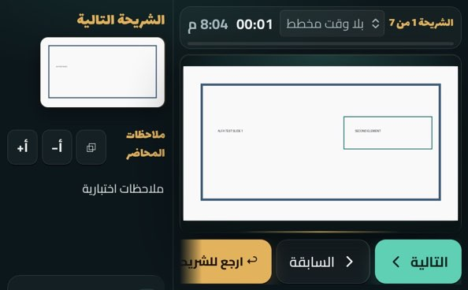 | 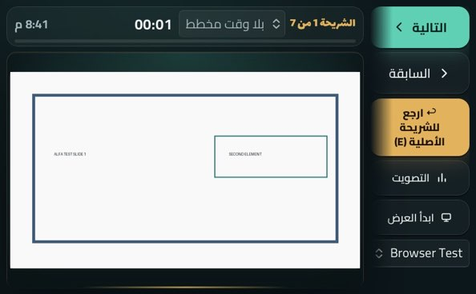 |
| مفتوح مع لوحة مثبتة 951×350 | 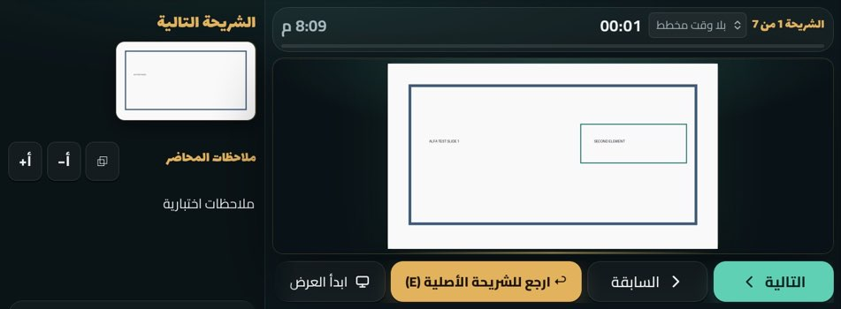 | 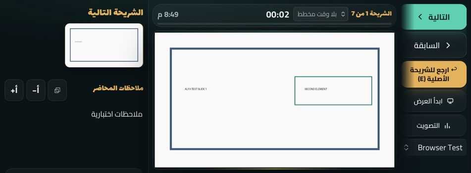 |
| D المحاضر 951×600 | 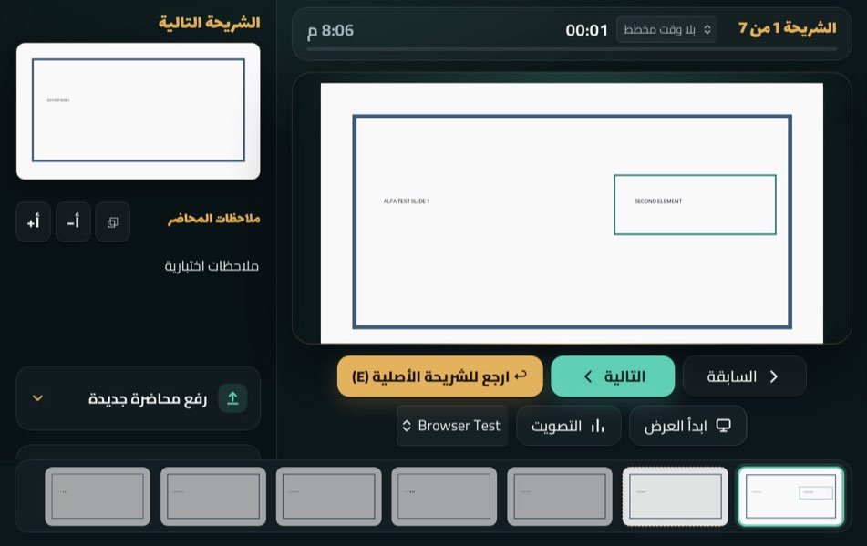 | 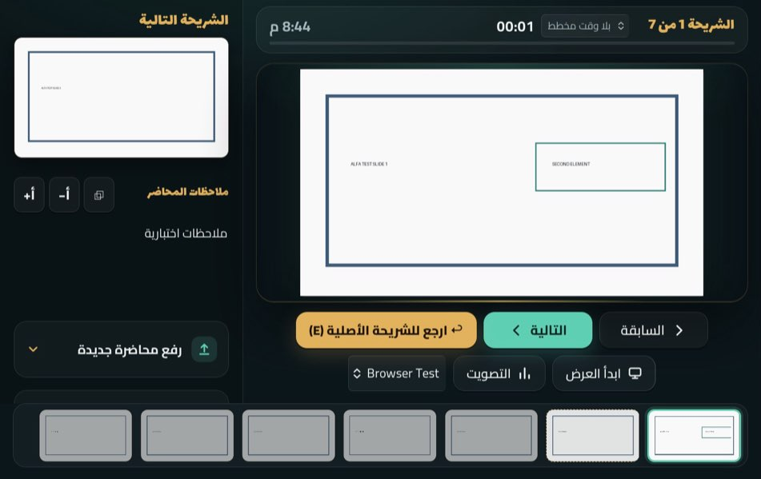 |
| A خطأ البروجكتر 382×580 | 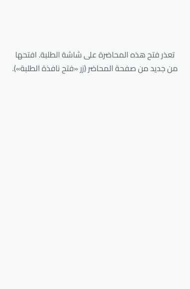 | 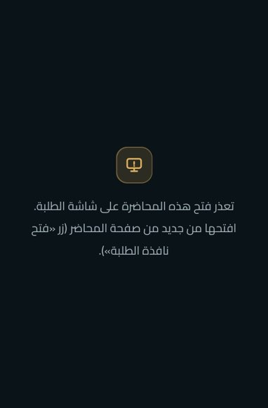 |
| الملاحظات 951×350 | 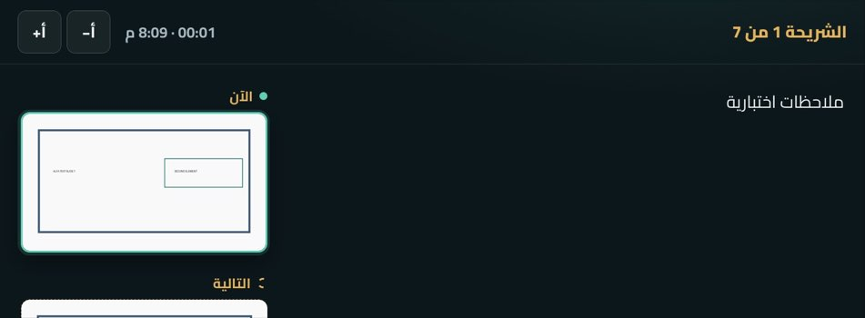 | 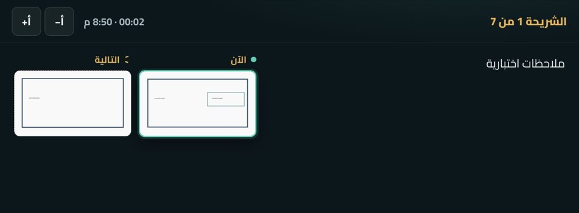 |
| C انتظار الطالب 669×880 | 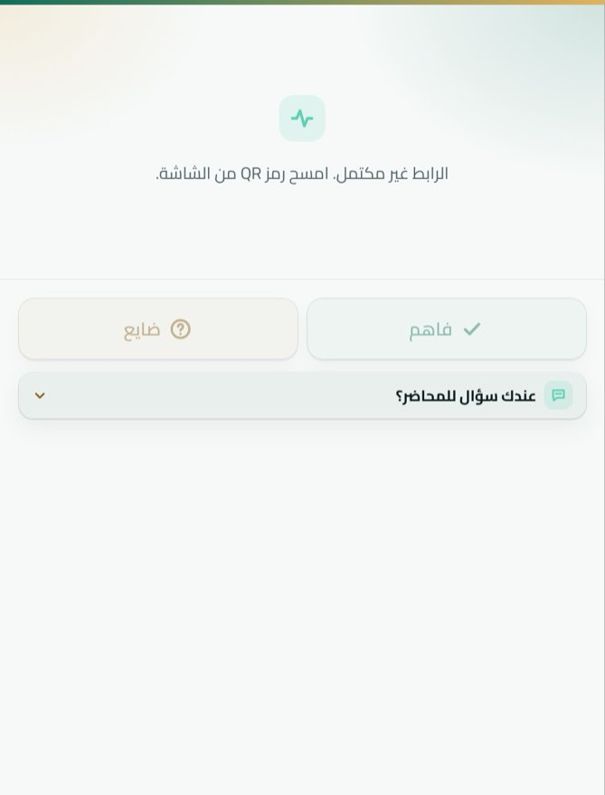 | 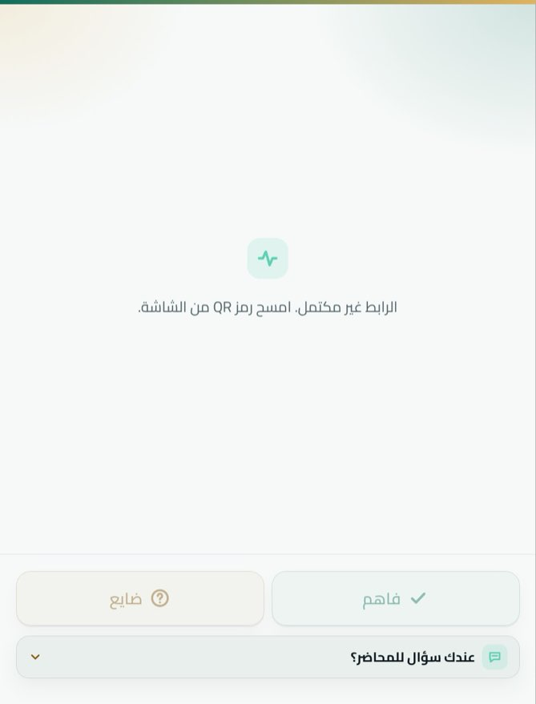 |
| J بعد الانتقال إلى 382×580 والفيديو يعمل | | 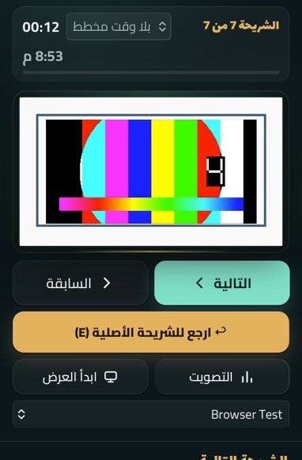 |

## 7. الوصول والاتجاه

- RTL: كل الصفحات `dir=rtl`؛ عمود المفاتيح عند الحافة اليمنى (بداية السطر). PASS.
- التكبير غير مقفول (`width=device-width, initial-scale=1, viewport-fit=cover`) و`touch-action: manipulation` على الأزرار. PASS.
- أهداف اللمس في عمود المفاتيح ≥ 44px (التالية/السابقة 52px). PASS. أزرار «المخرج الخفي» داخل الشريط الجانبي 38px على المكتب: سابقة، لم تُغيَّر (`PARTIAL`).
- تقليل الحركة: لا حركة جديدة. PASS.
- VoiceOver حقيقي: NOT_TESTED. النصوص المرئية للأزرار لم تتغير ولم يُخفَ أي نص.

## 8. الأداء

CSS فقط (+~120 سطرًا) وسطر JS واحد؛ لا مراقبي resize ولا JavaScript جديد في المسار الحي. Core Web Vitals: NOT_TESTED (تطبيق محلي).

## 9. الاختبارات بعد التعديل

| الفحص | محليًا (macOS، حمل الجهاز 75–175) | CI على PR #89 |
|---|---|---|
| `node --check` لكل JS | PASS | PASS (`unit`) |
| 21 مجموعة وحدات | PASS 21/21 | PASS (`unit`) |
| `test:build` | PASS (مع python-pptx في venv) | PASS (`unit`) |
| `test:e2e` | FAIL محليًا: مهلة 5 ثوانٍ لانتظار إيقاف الفيديو تحت الحمل؛ 30 فحصًا قبله PASS | PASS (`browser`) |
| `test:e2e-living`، `test:e2e-semantic` | FAIL محليًا: الخادم لم يبدأ خلال المهلة (حمل الجهاز)، لا فحص فشل | PASS (`browser`) |
| بقية e2e (return, memory, library, engagement, insight, field, scenes, voicenav, show, speech, stress, vote) | PASS 12/12 | PASS (`browser`) |
| تطبيق الماك (Electron) | لم يُشغَّل محليًا | PASS (`desktop`) |
| استيراد PowerPoint/PDF حقيقي | لم يُشغَّل محليًا | PASS (`import-real`) |
| مصفوفة WebKit 120 حالة | 0 تمرير أفقي، 0 أخطاء JS | — |
| الانتقال الحي J مع فيديو يعمل | PASS | — |

الإخفاقات المحلية الثلاثة مهلات تشغيل على جهاز مثقل بجلسات أخرى، لا فحوص تخطيط، ونفس الاختبارات نجحت كاملة في CI.

## 10. القيود وما يجب فحصه على جهاز حقيقي

1. هذه محاكاة WebKit في Playwright، لا جهاز Duo. الحواف غير المتماثلة، وعمود أزرار Safari في المطوي، ولوحة المفاتيح لم تُقَس.
2. Viewport Segments وDevice Posture خلف علم في Safari 27.1، فالوضعيات E وF وI لم تُختبر ولم يُبنَ لها تخطيط خاص.
3. على المحاكي/الجهاز: (أ) المطوي عرضيًا: هل عمود المفاتيح كامل وزر «ابدأ العرض» ظاهر بلا تمرير؟ (ب) افتح `/?bundle=xxxx#audience`: هل الخلفية داكنة والرسالة في المنتصف بلا تمرير؟ (ج) شغّل فيديو الشريحة ثم اطوِ/افتح الجهاز: هل يستمر الفيديو من موضعه؟ (د) في آيفون عرضي بنوتش: هل عمود المفاتيح بعيد عن النوتش؟
4. لا نشر: المشروع يعمل محليًا على جهاز المحاضر. الدمج إلى `main` هو التسليم، ويصل إلى المحاضر بسحب `main` وتشغيل `Start ALFA.command` أو إعادة بناء تطبيق الماك (`npm run build:mac`).
