# ALFA Cognitive Stage على iPhone Duo — الجولة النهائية: الكتاب المفتوح ومصفوفة الوضعيات الكاملة (14 نوفمبر 2026)

النطاق طبقة العرض فقط: كتلة جديدة في آخر [web/style.css](../web/style.css) (بعد كتلة جولة #89 مباشرة)، وسكربت تدقيق يدوي [tests/duo-final-audit.mjs](../tests/duo-final-audit.mjs)، وهذه الوثيقة ومجلد [iphone-duo-final/](iphone-duo-final/). لم يُمَسّ `app.js` ولا أي JavaScript في الصفحات، ولا الخادم ولا التصويت ولا الأمان ولا الاستيراد ولا تطبيق الماك ولا CI.

رموز الحالة: `PASS` مُقاس ومُشاهد، `PARTIAL` جزئي (السبب في الحاشية)، `FAIL` خلل باقٍ، `BLOCKED` غير قابل للوصول، `NOT_TESTED` لم يُختبر. كل القياسات محاكاة Playwright **WebKit** (DPR 1، تقليل الحركة)، لا جهاز حقيقي.

## 1. ما تغيّر

| الوضعية | قبل | بعد |
|---|---|---|
| C/D الكتاب المفتوح (669×867، 951×585) | لوحة المحاضر عمود ممدود: الشريحة والمفاتيح يقطعها خط الطي (8 عناصر عند 669، 3 عند 951)، وصفحات الطالب والمراجعة والإدارة والملاحظات والبداية الأولى بطاقات في المنتصف فوق الطي. **96 حالة** عبور للطي في المصفوفة | **صفحتان وحافة طي هادئة** (32px: ظل خفيف وخيط واحد، والخلفية مستمرة تحتها). الصفحة اليمنى للمهمة الأساسية، واليسرى للسياق. **0 عبور** |
| E وضع اللابتوب (951×350، 600×350) | المفاتيح عمود جانبي (#89) | المحتوى في الأعلى، و**المفاتيح لوحة على الحافة السفلى** كأسفل اللابتوب. اللوحة صف من الشبكة نفسها (أو صف أخير لاصق في العرض الضيق)، فلا تغطي الشريحة أبدًا |
| B الخارجي أفقيًا (594×368) | عمود مفاتيح بجانب الشريحة | الشاشة الأولى لوحة تحكم كاملة: الشريحة + عمود ساعة نحيل، ولوحة مفاتيح بصفين أسفلها؛ الشريحة التالية والملاحظات بتمريرة |
| A الخارجي مطويًا (382×580…) | — | بلا تغيير مقصود (مهمة واحدة واضحة؛ الخلفية حافة لحافة) |
| أهداف اللمس | 262 حالة دون 44px | 32 حالة، كلها على شاشات المكتب ≥1024px بالفأرة. على مقاسات الـ Duo وكل شاشة لمس صارت مفاتيح الدروج والساعة وحجم الملاحظات 44px |
| خلل سابق | لوحة جلسة التصويت تظهر قبل تسجيل الدخول (`.admin .grid` كان يتغلب على `[hidden]`) | مخفية حتى الدخول |
| نص 200% | «فاهم / ضايع» و«عندك سؤال للمحاضر؟» يدفعان الصفحة أفقيًا | يلتفّان |

### توزيع الصفحتين (RTL: اليمنى أولًا)

| الشاشة | الصفحة اليمنى (الأساس) | الصفحة اليسرى (السياق) |
|---|---|---|
| لوحة المحاضر | الشريط (الشريحة/الساعة)، الشريحة الحالية، المفاتيح؛ وفي الكتاب الطولي فهرس الشرائح شبكة بعمودين أسفلها | الشريحة التالية، الملاحظات (تملأ ما بقي)، الدروج؛ وفي الكتاب العرضي شريط الشرائح أسفلها |
| نافذة الملاحظات | نص الملاحظات | «الآن» و«التالية»؛ الساعة وحجم الخط في نصف الشريط الأيسر |
| صفحة الطالب | السؤال والخيارات (أو رسالة الانتظار في المنتصف) | «فاهم / ضايع» والسؤال الخاص، في منتصف الصفحة |
| المراجعة | الأقسام تنساب في عمودين كصفحتي كتاب | — |
| إدارة التصويت | الجلسة ورمز QR | محرر السؤال والنتائج والدروج |
| البداية الأولى | الترحيب والأيقونة | نموذج الرفع كبطاقة |
| خطأ المحاضر | رسالة الخطأ وأيقونة ورابط المحاضرة الحالية | بطاقة الرفع كاملة |
| رسالة واحدة (تحميل، خطأ، لا محاضرة، رابط ناقص، لم تُنشر) | البطاقة في منتصف الصفحة اليمنى | خلفية هادئة (عُرف الكتاب: الصفحة المقابلة لافتتاح الفصل بيضاء) |
| نافذة «أين تظهر شاشة الطلبة؟» | اللوحة على الصفحة اليمنى | الخلفية المعتمة تغطي الصفحتين وتمنع اللمس تحتها |
| البروجكتر (الشريحة للطلبة) | **استثناء موثّق**: صورة واحدة حافة لحافة كالصورة الممتدة على صفحتي مجلة؛ كل ما فوقها جزء من الشريحة | |

### قرارات تقنية
- كل شيء CSS (`@media screen` و`@container`/`cq` و`:has`)؛ لا مستمع resize ولا عرض شرطي، فالشريحة والفيديو وحقول الكتابة **العناصر نفسها** قبل الطي وبعده.
- كل استعلامات الكتاب واللابتوب مقيّدة بـ `screen`؛ الطباعة بعرض 669px ليست كتابًا (مُقاس).
- النطاقات: كتاب طولي 640–720 عرضًا و≥500 ارتفاعًا؛ كتاب عرضي 880–1000 و≥500 ونسبة ≥7:5 (فلا يصير آيباد 768×1024 أو 1024×768 كتابًا). لابتوب: ارتفاع ≤480 وعرض ≥560.
- المسافة بين الصفحتين = الطي + هامشان متساويان، والحشوة الخارجية متساوية في الطرفين، فمنتصف الفجوة هو منتصف الشاشة رياضيًا.
- تحسين اختياري معزول: `@media (horizontal-viewport-segments: 2)` يجعل عرض الطي مساويًا للفجوة الحقيقية بين الشاشتين عبر `env(viewport-segment-*)`. **NOT_TESTED** (WebKit لا يحاكي المقاطع).
- لا حركة جديدة، لا زجاج ثقيل، لا `!important` جديد.

## 2. جرد الشاشات (من `app.js` وصفحات `web/*.html`)

| المعرّف في التدقيق | الشاشة | كيف وُصل إليها |
|---|---|---|
| presenter | لوحة المحاضر الهادئة `/#presenter` | ملف الاختبار الاصطناعي (7 شرائح، فيديو في 7) |
| presenter-tools | لوحة المحاضر بكل الأدوات `?tools=1` | |
| presenter-voting-drawer | درج التصويت مفتوحًا مع إطار إدارة التصويت | زر «التصويت» |
| presenter-readiness | درج جاهزية العرض | فتح الدرج |
| presenter-import-open | درج «رفع محاضرة جديدة» | فتح الدرج |
| presenter-all-drawers | كل الدروج مفتوحة (المقررات، النبض، المحاضرة التجريبية، المسرح المعرفي، الجاهزية، التصويت، إدارة الذاكرة) | |
| presenter-showing | أثناء العرض (شاشة سوداء، حالة نافذة الطلبة) | «ابدأ العرض» ثم إغلاق النافذة المنبثقة |
| presenter-display-chooser | حوار «أين تظهر شاشة الطلبة؟» | محاكاة `window.alfaDesktop` في المتصفح |
| presenter-video | شريحة الفيديو | الانتقال للشريحة 7 |
| presenter-scene | مشهد إنفوجرافيك على الشريحة ونموذج المشهد (`?dev=1`) | النموذج «إنفوجرافيك» |
| presenter-first-run | البداية الأولى (لا محاضرة) | اعتراض `current.json` |
| presenter-error | محاضرة غير موجودة + بطاقة الرفع | `?bundle=missing-lecture` |
| presenter-loading | «جارٍ التحميل…» | تعليق `current.json` |
| audience / audience-blackout / audience-error / audience-empty | نافذة البروجكتر: شريحة، شاشة سوداء (إضافة الصنف مباشرة)، خطأ، لا محاضرة | |
| notes / notes-empty | نافذة الملاحظات وحالة الفراغ | |
| vote-incomplete / -waiting / -choice / -results / -words / -ask-open / -not-found / -offline | صفحة الطالب: رابط ناقص، انتظار، اختيار، نتائج، سحابة كلمات، سؤال خاص مفتوح، جلسة غير موجودة، انقطاع | اعتراض `/api/sessions/ABC123/state` |
| review-incomplete / -unpublished / -content / -offline | المراجعة: رابط ناقص، لم تُنشر، محتوى، انقطاع | اعتراض `/api/sessions/ABC123/review` |
| admin-auth / admin-panel / admin-panel-drawers | إدارة التصويت: الدخول، اللوحة بجلسة وسؤال، كل الدروج | الخادم المحلي (رمز اختبار)؛ شاشة الدخول باعتراض `/api/admin/check` |

غير مُدرج: لا يوجد في المستودع موجّه أو تبويبات أخرى. شاشة الضيف (`start:guest`) هي نفس لوحة المحاضر بعلَم تشغيل.

## 3. تعريف الوضعيات

A مطوي طولي 382×580، 385×571، 320×568 · B مطوي عرضي 594×368 · C كتاب طولي 669×867 · D كتاب عرضي 951×585 · E لابتوب 951×350، 600×350 · F داخلي قصير 669×520، 600×480 · G لوحي/مكتب 768×1024، 1024×768، 1280×800، 1440×900 · H هاتف 360×640، 390×844، 844×390 · I الانتقال الحي 951×585 → 669×867 → 470×700 → 382×580 → 594×368 → 951×350 → 951×585 على نفس الصفحة بلا إعادة تحميل · J ضغط الوصول (نص 200%، داكن، تقليل الحركة، لوحة مفاتيح، حواف أمان غير متماثلة).
إضافة: مقاسات Split 320/470/620 × 350/600/900 (لا تُحسب في A–J لكنها في التقرير).

## 4. مصفوفة الصفحات × الوضعيات

معيار PASS في A–H: 0 تمرير أفقي، 0 عناصر نص/تحكم في منطقة الطي (عند C وD وF 669×520)، 0 عناصر مقصوصة، ومفتاحا «التالية/السابقة» ظاهران وغير مغطَّين في الشاشة الأولى.

| الشاشة | A | B | C | D | E | F | G | H | I | J |
|---|---|---|---|---|---|---|---|---|---|---|
| presenter | PASS | PASS | PASS | PASS | PASS | PASS | PASS | PASS | PASS | PARTIAL³ |
| presenter-tools | PASS | PASS | PASS | PASS | PASS | PASS | PASS | PASS | PASS | PARTIAL⁴ |
| presenter-voting-drawer | PASS | PASS | PASS | PASS | PASS | PASS | PASS | PASS | NOT_TESTED² | PARTIAL⁴ |
| presenter-readiness | PASS | PASS | PASS | PASS | PASS | PASS | PASS | PASS | NOT_TESTED² | PARTIAL⁴ |
| presenter-import-open | PASS | PASS | PASS | PASS | PASS | PASS | PASS | PASS | NOT_TESTED² | PARTIAL⁴ |
| presenter-all-drawers | PASS | PASS | PASS | PASS | PASS | PASS | PASS | PASS | NOT_TESTED² | PARTIAL⁴ |
| presenter-showing | PASS | PASS | PASS | PASS | PASS | PASS | PASS | PASS | NOT_TESTED² | PARTIAL⁴ |
| presenter-display-chooser | PASS | PASS | PASS | PASS | PASS | PASS | PASS | PASS | PASS | PARTIAL⁴ |
| presenter-video | PASS | PASS | PASS | PASS | PASS | PASS | PASS | PASS | PASS | PARTIAL⁴ |
| presenter-scene | PASS | PASS | PASS | PASS | PASS | PASS | PASS | PASS | NOT_TESTED² | PARTIAL⁴ |
| presenter-first-run | PASS | PASS | PASS | PASS | PASS | PASS | PASS | PASS | PASS | PASS |
| presenter-error | PASS | PASS | PASS | PASS | PASS | PASS | PASS | PASS | NOT_TESTED² | PARTIAL⁴ |
| presenter-loading | PASS | PASS | PASS | PASS | PASS | PASS | PASS | PASS | NOT_TESTED² | PARTIAL⁴ |
| audience | PASS | PASS | PASS | PASS | PASS | PASS | PASS | PASS | PASS | PASS |
| audience-blackout | PASS | PASS | PASS | PASS | PASS | PASS | PASS | PASS | NOT_TESTED² | PARTIAL⁴ |
| audience-error | PASS | PASS | PASS | PASS | PASS | PASS | PASS | PASS | NOT_TESTED² | PARTIAL⁴ |
| audience-empty | PASS | PASS | PASS | PASS | PASS | PASS | PASS | PASS | NOT_TESTED² | PARTIAL⁴ |
| notes | PASS | PASS | PASS | PASS | PASS | PASS | PASS | PASS | PASS | PARTIAL³ |
| notes-empty | PASS | PASS | PASS | PASS | PASS | PASS | PASS | PASS | NOT_TESTED² | PARTIAL⁴ |
| vote-incomplete | PASS | PASS | PASS | PASS | PASS | PASS | PASS | PASS | NOT_TESTED² | PARTIAL⁴ |
| vote-waiting | PASS | PASS | PASS | PASS | PASS | PASS | PASS | PASS | PASS | PASS |
| vote-choice | PASS | PASS | PASS | PASS | PASS | PASS | PASS | PASS | PASS | PARTIAL³ |
| vote-results | PASS | PASS | PASS | PASS | PASS | PASS | PASS | PASS | PASS | PARTIAL⁴ |
| vote-words | PASS | PASS | PASS | PASS | PASS | PASS | PASS | PASS | NOT_TESTED² | PARTIAL⁴ |
| vote-ask-open | PASS | PASS | PASS | PASS | PASS | PASS | PASS | PASS | PASS | PARTIAL⁴ |
| vote-not-found | PASS | PASS | PASS | PASS | PASS | PASS | PASS | PASS | NOT_TESTED² | PARTIAL⁴ |
| vote-offline | PASS | PASS | PASS | PASS | PASS | PASS | PASS | PASS | NOT_TESTED² | PARTIAL⁴ |
| review-incomplete | PASS | PASS | PASS | PASS | PASS | PASS | PASS | PASS | NOT_TESTED² | PARTIAL⁴ |
| review-unpublished | PASS | PASS | PASS | PASS | PASS | PASS | PASS | PASS | NOT_TESTED² | PARTIAL⁴ |
| review-content | PASS | PASS | PASS | PASS | PASS | PASS | PASS | PASS | PASS | PARTIAL³ |
| review-offline | PASS | PASS | PASS | PASS | PASS | PASS | PASS | PASS | NOT_TESTED² | PARTIAL⁴ |
| admin-auth | PASS | PASS | PASS | PASS | PASS | PASS | PASS | PASS | NOT_TESTED² | PARTIAL⁴ |
| admin-panel | PASS | PASS | PASS | PASS | PASS | PASS | PASS | PASS | PASS | PARTIAL³ |
| admin-panel-drawers | PASS | PASS | PASS | PASS | PASS | PASS | PASS | PASS | NOT_TESTED² | PARTIAL⁴ |

الحواشي:
- ² لم يُشغَّل له تسلسل حي منفصل؛ الشاشة الأم مرّت بالتسلسل كاملًا، والتكيّف CSS بحت.
- ³ عند نص 200% فقط: اللوحة اليمنى في 951×585 تتمرر فيصبح المفتاحان تحت الطية (يُصل إليهما بالتمرير)؛ وعند 669×867 بعض الخيارات/عناصر المراجعة الطويلة تتجاوز عرض صفحة 318px إلى منطقة الطي؛ وتمرير أفقي في 594×368 و382×580 للمحاضر والملاحظات والإدارة **موجود كما هو على `main`** (قِيس بنفس السكربت مع `BASELINE=1`). الداكن وحواف الأمان غير المتماثلة ولوحة المفاتيح: PASS.
- ⁴ تقليل الحركة مُفعّل في كل تشغيل؛ بقية ضغوط J قيست على الشاشة الأم فقط.

### I — الانتقال الحي (60 خطوة، PASS)
- **المحاضر مع فيديو يعمل**: نفس عنصر `<video>` في كل خطوة، لم يتوقف، والمؤشر يتقدم في كل المقاسات الست؛ الشريحة 7 ثابتة؛ اختيار «المدة المخططة» باقٍ؛ نص مكتوب في حقل باقٍ.
- ملاحظة صادقة: حين يكون حقل في أسفل اللوحة مُركَّزًا، يمرّر المتصفح الصفحة إليه في المقاسات الهاتفية فيخرج الفيديو من النظر؛ WebKit يجمّد إطارات الفيديو الصامت خارج النظر وهو «يعمل»، ويتابع عند العودة. التشغيل الثاني بلا حقل مركّز أثبت التقدم في كل المقاسات.
- موضع تمرير اللوح الجانبي يعود إلى 0 حين يمر التخطيط بعرض الهاتف (اللوح هناك ليس حاوية تمرير). `PARTIAL` معروف.
- الطالب: النص المكتوب، الدرج المفتوح، الإجابة المختارة باقية. الملاحظات: حجم الخط والشريحة باقيان. الحوار: يبقى مفتوحًا في كل الخطوات. البروجكتر/المراجعة/الإدارة/البداية/الانتظار: الحالة باقية، 0 تمرير أفقي.

### الحوار فوق الكتاب
عند 669×867 و951×585 اللوحة على الصفحة اليمنى بالكامل؛ نقرة على الصفحة الأخرى (حيث شريط الشرائح) **لم تغيّر الشريحة**، والخلفية تغطي الشاشة كلها. وكذلك 382×580 و951×350. PASS.

### الطباعة
عند 669px مع `print`: الشبكة `minmax(0,1fr) 280px` بلا طي (`::before` = none). PASS.

## 5. الأرقام (التقرير: [iphone-duo-final/audit-report.json](iphone-duo-final/audit-report.json))

| المقياس (884 حالة شاشة×مقاس) | `main` (قبل) | بعد |
|---|---|---|
| تمرير أفقي | 0 | 0 |
| حالات عبور الطي | 96 | **0** |
| عناصر مقصوصة | 0 | 0 |
| مفاتيح غير ظاهرة في الشاشة الأولى | 1 (Split 320×350) | 1 (نفسها) |
| حالات أهداف لمس < 44px | 262 | 32 (مكتب ≥1024 فقط) |
| أخطاء JS | 0 | 0 |
| J: داكن / حواف أمان / لوحة مفاتيح | — | 0 / 0 / 0 مشاكل |

## 6. صور قبل/بعد (WebKit، DPR 1)

| | قبل | بعد |
|---|---|---|
| C المحاضر 669×867 | 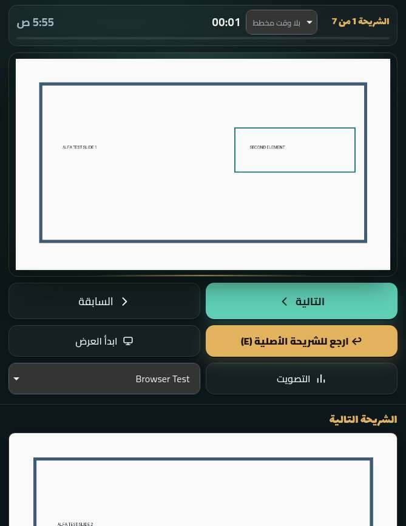 | 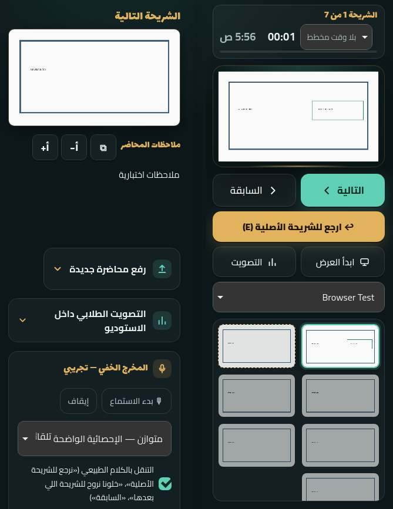 |
| D المحاضر 951×585 | 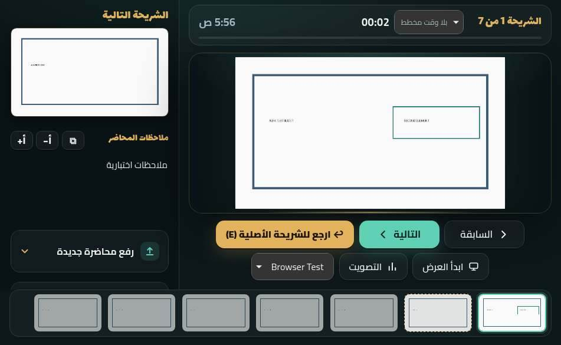 | 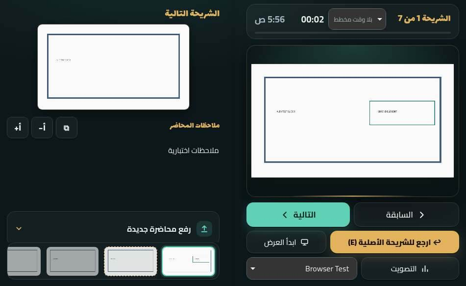 |
| C الملاحظات 669×867 | 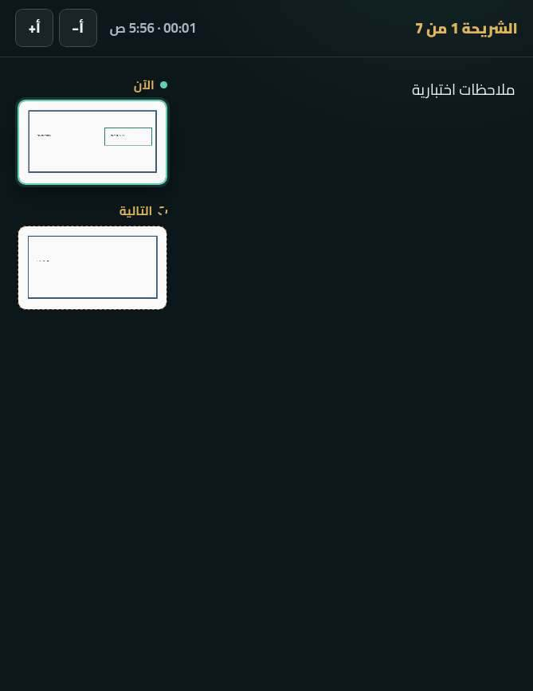 | 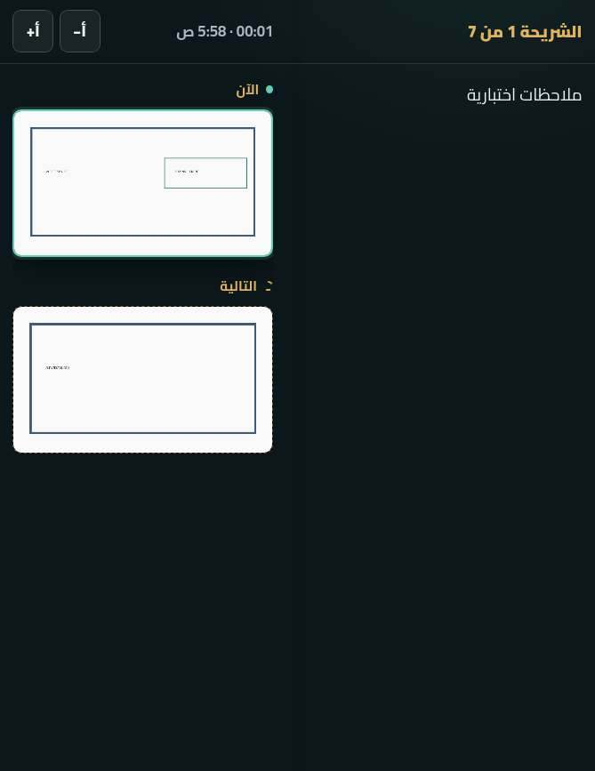 |
| D الطالب 951×585 | 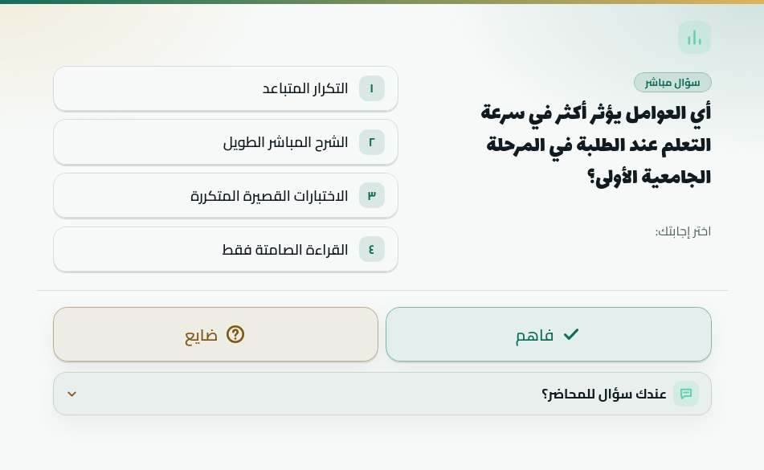 | 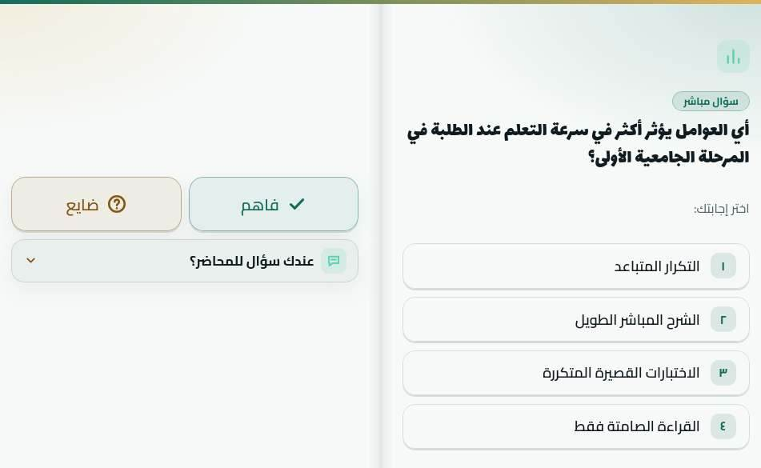 |
| D الحوار 951×585 | | 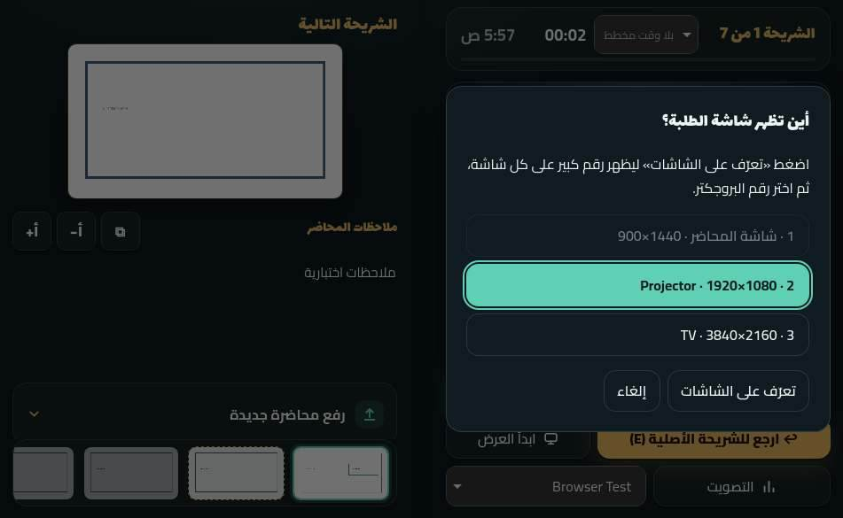 |
| E اللابتوب 951×350 | | 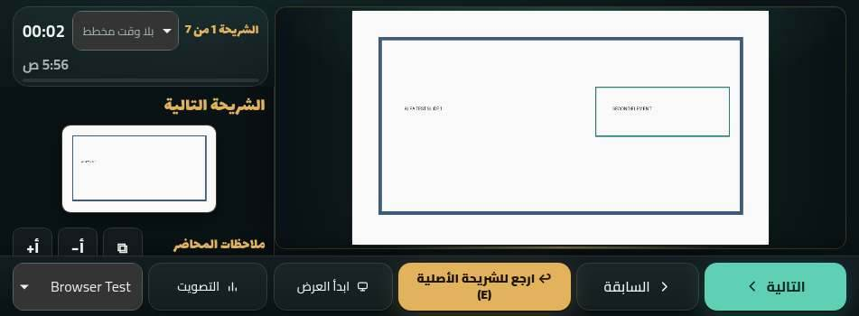 |
| B المطوي عرضيًا 594×368 | | 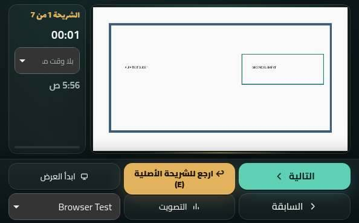 |
| A المطوي 382×580 | | 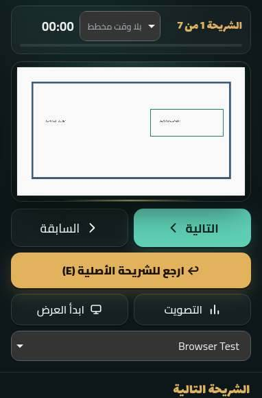 |

## 7. إعادة التدقيق

```
python3 tools/make_test_fixture.py      # مرة واحدة: المحاضرة الاصطناعية
NODE_PATH=/opt/node22/lib/node_modules PLAYWRIGHT_BROWSERS_PATH=/opt/pw-browsers \
  SHOTS=/tmp/alfa-duo-shots node tests/duo-final-audit.mjs
```
يشغّل خادمه على المنفذ 5210 (`PORT`)، أو يستعمل خادمًا قائمًا بـ `BASE=http://localhost:5210 ADMIN_TOKEN=…`. `BASELINE=1` يقدّم `style.css` من `origin/main` للمقارنة، و`ONLY=presenter,live,stress` لجزء. لا يكتب إلا على الخادم المحلي (جلسة وسؤال تصويت تجريبيان في `data/` المتجاهَل).

## 8. الاختبارات

| الفحص | محليًا |
|---|---|
| `node --check` لكل JS (والسكربت الجديد) | PASS |
| مجموعات وحدات CI الـ 21 | PASS 21/21 |
| e2e (Chromium) | لم تُشغَّل محليًا (لا Chromium على هذا الجهاز) — تُشغَّل في CI (`browser`) |
| lint / typecheck / build | لا يوجد في المستودع |

## 9. المشاكل الباقية

- **P0**: لا شيء معروف.
- **P1**: البروجكتر في وضع الكتاب يمد الشريحة عبر الطي (استثناء مقصود؛ إن كان البروجكتر فعلًا على شاشة Duo الداخلية فالأفضل قلب الجهاز إلى وضع الخيمة). الطي على المقاطع الحقيقية NOT_TESTED.
- **P2**: نص 200%: اللوحة اليمنى في 951×585 تتمرر، وبعض الخيارات الطويلة تدخل منطقة الطي عند 669×867؛ تمرير أفقي سابق في 594×368/382×580. قائمة «المدة المخططة» تُقصّ نصها («بلا وقت م…») في عمود الساعة عند 594×368. موضع تمرير اللوح الجانبي يعود للصفر عند المرور بعرض الهاتف. أهداف 38px في المكتب بالفأرة (سابقة). الصفحة اليسرى فارغة عمدًا في شاشات الرسالة الواحدة.

## 10. قائمة المالك على الجهاز الحقيقي

1. افتح الجهاز كتابًا (طولي ثم عرضي) على `/#presenter`: هل يقع خط الطي في الفجوة بين الصفحتين تمامًا؟ هل الشريحة والمفاتيح على اليمنى والتالية والملاحظات على اليسرى؟
2. شغّل فيديو الشريحة ثم اطوِ وافتح ثم ضعه لابتوب: هل يستمر الصوت والصورة بلا توقف، والشريحة نفسها؟
3. وضع اللابتوب: هل لوحة المفاتيح في الأسفل كاملة ولا تغطي الشريحة؟ هل تتأثر بشريط Safari السفلي؟
4. صفحة الطالب `vote.html?s=…` مفتوحة كتابًا: السؤال يمينًا و«فاهم / ضايع» يسارًا؟ ومع لوحة المفاتيح على «عندك سؤال للمحاضر؟»: هل الحقل ظاهر؟
5. إن كشف Safari `viewport-segments`: هل يتطابق الطي المرسوم مع المفصل؟ (غير مُختبر)
6. حواف الأمان الحقيقية (الكاميرا/الزوايا) في كل وضعية.
